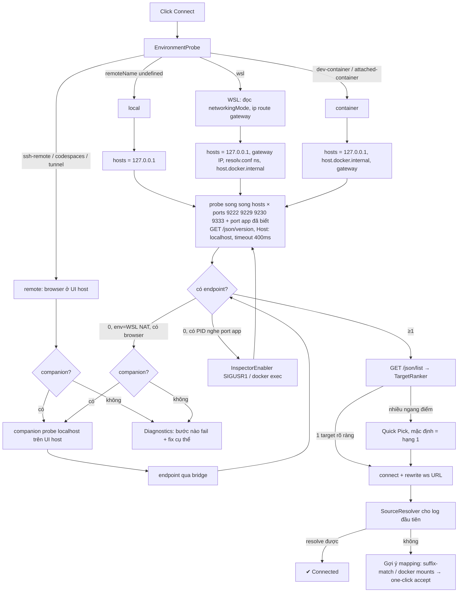

# Đề xuất: Runtime log chạy được trên WSL / Docker / Remote SSH / Dev Container

**Ngày:** 2026-09-15 · **Trạng thái:** bản nháp để grill — CHƯA phải spec, chưa tách ticket
**Nguồn:** yêu cầu người dùng ngày 2026-09-15 ("extension chưa support WSL"), đối chiếu với code
thực tế sau ticket 13 (`v0.2.3`).

> Tài liệu này có hai phần: (A) đối chiếu yêu cầu với code + **các chỗ yêu cầu gốc sai về kỹ thuật**,
> (B) kiến trúc, flowchart, kế hoạch TypeScript, roadmap, tương thích ngược, code mẫu, ma trận test.
> Các quyết định đánh dấu **[cần chốt]** phải qua `/grill-with-docs` trước khi `/to-spec`.

---

## A. Hiện trạng và gap

### A1. Code hiện tại giả định gì

| Chỗ | Giả định ngầm | Hỏng ở đâu |
|---|---|---|
| `extension.ts` `launchChromeDebug` | `spawn(chrome)` chạy **cùng máy** với extension host | WSL/SSH/container: extension host ở remote → spawn Chrome Linux (hoặc fail), không phải Chrome Windows/laptop của người dùng |
| `extension.ts` `userDataDir = globalStorageUri.fsPath` | profile nằm trên máy chạy Chrome | WSL + Chrome Windows: đường `/home/...` vô nghĩa với `chrome.exe` |
| `runtime-log.ts` `discoverTargets(host, port)` | `http.get({host})` → header `Host: <host>` | Chrome **và** Node inspector từ chối Host không phải IP/`localhost` (chống DNS rebinding) → `host.docker.internal` fail dù mạng thông |
| `index.ts` `startRuntimeLogConnection(key, target.webSocketDebuggerUrl)` | URL WebSocket trả về dùng được nguyên văn | Chrome/Node dựng `ws://` từ Host header / địa chỉ bind (`127.0.0.1`) → khi reach qua IP khác phải **rewrite host:port** của ws URL |
| `findPidListeningOnPort` + `SIGUSR1` (ticket 10) | tiến trình app nằm cùng network namespace + PID namespace | Docker: `lsof` host không thấy PID trong container; inspector bật lên bind `127.0.0.1` **trong** container → không reach được |
| `mapContainerPath` (ticket 11) | người dùng tự khai prefix | chính là pain point #6/#7 |
| `workspace.toRelative` (ticket 12) | không có symlink | WSL `/mnt/c/...` vs `\\wsl$`, macOS `/private/var` |
| `parseHostPort` UI | người dùng biết port | pain point #4 |

### A2. Chỗ yêu cầu gốc cần sửa trước khi làm (quan trọng)

1. **`/etc/resolv.conf` nameserver KHÔNG đáng tin là IP Windows host.** Từ WSL 2.2 bật
   `dnsTunneling` (mặc định trên bản mới) → nameserver là `10.255.255.254`, không phải host. Người
   dùng tắt `generateResolvConf` hoặc dùng VPN cũng làm sai. Nguồn đáng tin hơn:
   `ip route show default` (gateway của vEthernet WSL). Giữ `resolv.conf` chỉ làm ứng viên phụ.
2. **Có IP Windows đúng vẫn chưa đủ.** Chrome headful bind DevTools **chỉ trên `127.0.0.1`**;
   `--remote-debugging-address=0.0.0.0` chỉ còn tác dụng ở headless. Nên ở WSL2 chế độ NAT, bước
   "thử `http://<windows-host-ip>:9222/json`" sẽ **thất bại gần như luôn** với Chrome thường, trừ khi
   người dùng tự `netsh portproxy` + mở firewall (trái mục tiêu zero-config, và mở debug port ra LAN là
   lỗ bảo mật). Chỉ hai đường thật sự chạy:
   - WSL `networkingMode=mirrored` (Win11 22H2+): `127.0.0.1` thông hai chiều → Step 1 thành công.
   - **Companion chạy phía UI** (Windows/laptop) nói chuyện với Chrome qua localhost của chính nó —
     đúng cách `vscode-js-debug` giải bài này (`js-debug-companion`). → xem B1, **[cần chốt]**.
3. **`host.docker.internal`** chỉ resolve trong container Docker Desktop (và đôi khi trong WSL do
   `/etc/hosts` sinh từ Windows hosts). Dùng được làm ứng viên, nhưng bắt buộc gửi `Host: localhost`
   (xem A1) và không phải lời giải cho WSL.
4. **Chrome 136+ bỏ qua `--remote-debugging-port` trên profile mặc định** — phải có
   `--user-data-dir` riêng. Code hiện tại đã đúng; phần "tự tìm Chrome đang chạy của người dùng"
   trong yêu cầu #4 vì vậy chỉ thấy được Chrome do chính extension mở (hoặc người dùng tự mở kèm
   profile riêng). Diagnostics phải nói rõ điều này thay vì báo "không tìm thấy".
5. **Scan port qua IP host** dính firewall Windows → mỗi probe treo tới timeout. Phải probe song song,
   timeout ngắn (~300–500 ms), có huỷ; nếu không mục tiêu "< 30 giây" không giữ được.
6. **`docker inspect` Mounts trên Docker Desktop + WSL** trả `Source` dạng
   `/run/desktop/mnt/host/c/...` hoặc `/mnt/wsl/docker-desktop-bind-mounts/...` — cần chuẩn hoá
   trước khi so với workspace. Và #7 (suffix match với file index sẵn có của server) giải được phần
   lớn trường hợp **mà không cần Docker CLI** → nên làm #7 trước #6, #6 chỉ là gợi ý bổ sung.
7. **Log từ browser mang URL HTTP** (`http://localhost:3100/js/app.js`, xác nhận ở ticket 02b), không
   phải đường file. Resolver #7 phải xử lý cả URL (lấy pathname rồi suffix match), không chỉ path.
8. **Remote SSH / Codespaces:** Chrome ở laptop, extension ở server — không có IP nào để "thử"; chỉ
   companion hoặc port forwarding. Node app trên server thì như local.

---

## B. Đề xuất

### B1. Kiến trúc

Nguyên tắc: tách **"reach được ở đâu"** (Endpoint) khỏi **"kết nối cái gì"** (Target) khỏi
**"log thuộc file nào"** (Source). Mỗi phần là một module sâu với interface nhỏ, test được bằng hàm
thuần + fake prober.

```
┌────────────── UI side (máy người dùng: Windows / macOS / laptop) ──────────────┐
│  ejsng-runtime-companion  (extensionKind: ["ui"])      [cần chốt: có làm không] │
│   • BrowserLocator (tìm chrome/edge/brave trên máy UI)                          │
│   • launch browser + probe 127.0.0.1:922x                                       │
│   • CdpBridge: Chrome CDP (localhost) ⇄ cổng đã forward từ workspace side      │
└──────────────────────────────▲─────────────────────────────────────────────────┘
                               │ vscode.commands (cross-host) + env.asExternalUri
┌──────────────────────────────┴── Workspace side (local / WSL / SSH / container) ┐
│  vscode-client (extension.ts)                                                   │
│   • EnvironmentProbe  → RuntimeEnvironment  (vscode.env.remoteName, WSL_*, …)   │
│   • Setup wizard / Diagnostics webview / Troubleshooting report                 │
│        │ initializationOptions + ejsng/* requests                               │
│  server (LSP)                                                                   │
│   • EndpointResolver   candidates(env) → probe /json/version → Endpoint[]       │
│   • RuntimeDiscovery   scan ports × hosts → DiscoveredRuntime[] (browser|node)  │
│   • TargetRanker       (pure) lọc + xếp hạng tab                                │
│   • InspectorEnabler   SIGUSR1 local | docker exec kill -USR1 (best-effort)     │
│   • SourceResolver     chain: pathMappings → realpath → suffix-match index      │
│                        → docker mount hints                                     │
│   • ConnectionManager  (hiện có: runtimeLogConnections + startRuntimeLogConnection) │
└─────────────────────────────────────────────────────────────────────────────────┘
```

Vì sao companion: đó là cách duy nhất zero-config cho `Chrome Windows + VS Code WSL (NAT)`,
`Remote SSH`, `Codespaces` mà **không** mở debug port ra mạng. Giá phải trả: thêm 1 extension
(có thể gói chung qua `extensionPack`), thêm 1 lớp bridge. Phương án thay thế rẻ hơn cho phase 1:
chỉ hỗ trợ WSL mirrored + hướng dẫn trong Diagnostics — **[cần chốt]**, nên `/prototype` bridge trước.

`RuntimeEnvironment` (đặt ở `packages/core` hoặc một file types dùng chung client+server):

```ts
export type RemoteKind = 'local' | 'wsl' | 'ssh' | 'container' | 'codespace' | 'tunnel';

export interface RuntimeEnvironment {
  kind: RemoteKind;
  /** Raw vscode.env.remoteName — undefined, 'wsl', 'ssh-remote', 'dev-container', 'attached-container', 'codespaces', 'tunnel'. */
  remoteName: string | undefined;
  /** OS the workspace side (extension host + LSP server) runs on. */
  workspaceOs: 'win32' | 'darwin' | 'linux';
  wsl?: { distro: string; networking: 'nat' | 'mirrored' | 'unknown'; windowsHostIp?: string };
  /** Where a browser the user looks at lives, relative to the workspace side. */
  browserSide: 'same-host' | 'ui-host' | 'unknown';
  /** Whether a UI-side companion answered a ping. */
  companion: 'available' | 'missing' | 'not-needed';
  docker: { cli: boolean; insideContainer: boolean };
}
```

### B2. Detection flowchart



### B3. Kế hoạch TypeScript (module → file → seam test)

| Module | File đề xuất | Interface | Test |
|---|---|---|---|
| EnvironmentProbe | `vscode-client/src/runtime/environment.ts` (+ phần thuần ở `server/src/runtime/environment-parse.ts`) | `probeEnvironment(deps): Promise<RuntimeEnvironment>`; parser thuần `parseWslConfig`, `parseIpRouteDefault`, `parseResolvConf` | fixture text, không cần WSL thật |
| BrowserLocator | `runtime/browser-locator.ts` (dùng được ở cả companion) | `locateBrowsers(platform, fs, which): Promise<BrowserCandidate[]>` theo thứ tự Chrome → Chromium → Edge → Brave; WSL: thêm `/mnt/c/Program Files/...` + `wslpath -w` cho `--user-data-dir` | fake fs |
| EndpointResolver | `server/src/runtime/endpoints.ts` | `candidateHosts(env): string[]`; `probeEndpoint(host, port, {timeoutMs, signal}): Promise<Endpoint \| null>` | fake HTTP server bind IP thật (đã có tiền lệ ở `runtime-log-discovery.test.js`) |
| RuntimeDiscovery | `server/src/runtime/discovery.ts` | `discoverRuntimes(env, {extraPorts}): Promise<DiscoveredRuntime[]>` | fake prober |
| TargetRanker | `server/src/runtime/rank-targets.ts` | `rankTargets(targets, hints): RankedTarget[]` (thuần) | bảng case |
| InspectorEnabler | tách từ `discoverTargetsWithAutoEnable` | `enableInspector(port, env): Promise<Endpoint \| null>` | giữ test ticket 10 |
| SourceResolver | `server/src/runtime/source-resolver.ts` | `resolveSource(urlOrPath, ctx): Resolution` với `ctx = {mappings, root, index, realpath}`; trả kèm `suggestion?: PathMapping` | thuần, bảng case |
| DockerMounts | `server/src/runtime/docker.ts` | `parseDockerInspect(json): PathMapping[]`, `normalizeDesktopSource(p)` | fixture `docker inspect` thật |
| Diagnostics | `server/src/runtime/diagnostics.ts` + webview client | `runDiagnostics(): DiagnosticReport`; `formatReport(r): string` (markdown, không PII ngoài path) | snapshot text |
| Companion | package mới `packages/vscode-companion` | commands `ejsngCompanion.ping/locate/launch/bridge` | **prototype trước** |

LSP request mới (giữ request cũ):
- `ejsng/detectRuntimes` → `{ env, runtimes: DiscoveredRuntime[], ranked: RankedTarget[] }`
- `ejsng/runDiagnostics` → `DiagnosticReport`
- `ejsng/suggestPathMappings` → `PathMapping[]`
- `ejsng/connectRuntime` giữ nguyên `{host, port}`; thêm tuỳ chọn `{ runtimeId }`.

### B4. Roadmap refactor (thứ tự đề xuất — mỗi dòng ≈ 1 ticket tracer-bullet)

0. **Nền:** ticket 12 (realpath) + sửa Host header & rewrite ws URL — bug thật, nhỏ, không phụ thuộc gì.
1. **SourceResolver suffix-match** (URL + path) trên file index sẵn có → xoá nhu cầu pathMappings
   cho Docker/browser trong đa số case. Giá trị cao nhất / rủi ro thấp nhất.
2. **EnvironmentProbe + candidateHosts + probe song song** → WSL mirrored & Docker published port chạy
   zero-config. Nút Connect không cần gõ host:port (ô nhập thành "Advanced").
3. **TargetRanker + auto-select** (hợp nhất ticket 04 đang treo).
4. **Diagnostics webview + copyable report** — làm sớm vì mọi case chưa hỗ trợ đều rơi vào đây.
5. **BrowserLocator** thay `defaultChromeExecutablePath` (kèm WSL interop, `wslpath`).
6. **Docker mount hints + one-click accept** (ghi vào workspace settings).
7. **Setup wizard** = chuỗi 2→6 chạy tuần tự + lưu kết quả; không có logic riêng.
8. **Companion extension** (sau prototype) → WSL NAT, SSH, Codespaces.
9. InspectorEnabler cho Docker (`docker exec kill -USR1`) — best-effort, cảnh báo bind 127.0.0.1.

Ticket 09 (nợ verify UI) nên được xử lý trước bước 2, vì bước 2 thay chính luồng UI chưa verify.

### B5. Tương thích ngược

- Mọi setting hiện có **giữ nguyên nghĩa, trở thành override**: `pathMappings` luôn thắng
  suffix-match; `chromeExecutablePath` khác rỗng thì bỏ qua BrowserLocator; `chromeDebugPort` được
  đưa lên đầu danh sách port scan.
- Setting mới đều có default "auto": `ejsng.runtimeLog.hosts: []` (rỗng = auto),
  `ejsng.runtimeLog.scanPorts: [9222, 9229, 9230, 9333]`, `ejsng.runtimeLog.autoSelectTarget: true`.
- LSP: `ejsng/connectRuntime {host,port}` và `connectRuntimeTarget` không đổi shape → IntelliJ port
  (ticket 03) không bị phá. Chỉ thêm field tuỳ chọn.
- Ô `host:port` trong panel giữ lại dưới mục "Advanced / manual".
- Không tự ghi settings khi chưa bấm accept (tránh bẩn `settings.json` của repo người dùng).
- Không gỡ `SIGUSR1` path; chỉ bọc lại sau `InspectorEnabler`.

### B6. Code mẫu

**WSL host discovery** (server side, parser thuần + IO mỏng):

```ts
import { execFile } from 'node:child_process';
import { readFile } from 'node:fs/promises';

/** `ip route show default` → "default via 172.29.64.1 dev eth0 ..." → "172.29.64.1". */
export function parseDefaultGateway(ipRouteOutput: string): string | null {
  const m = /^default via (\d{1,3}(?:\.\d{1,3}){3})\b/m.exec(ipRouteOutput);
  return m?.[1] ?? null;
}

/** First IPv4 `nameserver` — ignores WSL's DNS-tunneling stub, which is not the Windows host. */
export function parseResolvConfNameserver(text: string): string | null {
  for (const line of text.split('\n')) {
    const m = /^\s*nameserver\s+(\d{1,3}(?:\.\d{1,3}){3})\s*$/.exec(line);
    if (m?.[1] && m[1] !== '10.255.255.254') return m[1];
  }
  return null;
}

export function isWsl(env: NodeJS.ProcessEnv, osRelease: string): boolean {
  return Boolean(env.WSL_DISTRO_NAME) || /microsoft/i.test(osRelease);
}

const run = (cmd: string, args: string[]) =>
  new Promise<string>((resolve) => execFile(cmd, args, { timeout: 1000 }, (err, out) => resolve(err ? '' : out)));

/** Ordered, de-duplicated hosts worth probing from inside WSL. Never throws. */
export async function wslCandidateHosts(): Promise<string[]> {
  const [route, resolv] = await Promise.all([
    run('ip', ['route', 'show', 'default']),
    readFile('/etc/resolv.conf', 'utf8').catch(() => ''),
  ]);
  const hosts = ['127.0.0.1', parseDefaultGateway(route), parseResolvConfNameserver(resolv), 'host.docker.internal'];
  return [...new Set(hosts.filter((h): h is string => Boolean(h)))];
}
```

**Runtime auto-discovery** (probe song song, Host header an toàn, rewrite ws URL):

```ts
import { get as httpGet } from 'node:http';

export type RuntimeKind = 'chrome' | 'edge' | 'chromium' | 'brave' | 'node' | 'unknown';

export interface Endpoint {
  host: string;
  port: number;
  kind: RuntimeKind;
  product: string; // e.g. "Chrome/128.0.6613.84" or "node.js/v20.11.0"
}

function getJson(host: string, port: number, path: string, timeoutMs: number, signal?: AbortSignal): Promise<unknown> {
  return new Promise((resolve, reject) => {
    // Chrome and Node's inspector reject any Host header that isn't an IP or "localhost"
    // (DNS-rebinding protection), so a hostname like host.docker.internal must lie here.
    const req = httpGet({ host, port, path, timeout: timeoutMs, signal, headers: { Host: `localhost:${port}` } }, (res) => {
      const chunks: Buffer[] = [];
      res.on('data', (c: Buffer) => chunks.push(c));
      res.on('end', () => {
        try {
          resolve(JSON.parse(Buffer.concat(chunks).toString('utf8')));
        } catch (err) {
          reject(err);
        }
      });
    });
    req.on('timeout', () => req.destroy(new Error(`timeout ${host}:${port}`)));
    req.on('error', reject);
  });
}

export function classifyVersion(body: unknown): { kind: RuntimeKind; product: string } | null {
  if (typeof body !== 'object' || body === null) return null;
  const b = body as { Browser?: unknown; 'User-Agent'?: unknown; Protocol?: unknown };
  const browser = typeof b.Browser === 'string' ? b.Browser : '';
  const ua = typeof b['User-Agent'] === 'string' ? b['User-Agent'] : '';
  if (/^node\.js/i.test(browser)) return { kind: 'node', product: browser };
  if (/Edg\//.test(ua)) return { kind: 'edge', product: browser };
  if (/Brave/i.test(ua) || /Brave/i.test(browser)) return { kind: 'brave', product: browser };
  if (/^HeadlessChrome|^Chrome/.test(browser)) return { kind: 'chrome', product: browser };
  if (/Chromium/i.test(browser)) return { kind: 'chromium', product: browser };
  return browser ? { kind: 'unknown', product: browser } : null;
}

export async function probeEndpoint(host: string, port: number, timeoutMs = 400, signal?: AbortSignal): Promise<Endpoint | null> {
  try {
    const cls = classifyVersion(await getJson(host, port, '/json/version', timeoutMs, signal));
    return cls ? { host, port, ...cls } : null;
  } catch {
    return null;
  }
}

/** Probe every host × port at once; the first host that answers a given port wins for that port. */
export async function discoverEndpoints(hosts: string[], ports: number[], signal?: AbortSignal): Promise<Endpoint[]> {
  const results = await Promise.all(ports.flatMap((port) => hosts.map((host) => probeEndpoint(host, port, 400, signal))));
  const byPort = new Map<number, Endpoint>();
  for (const e of results) if (e && !byPort.has(e.port)) byPort.set(e.port, e);
  return [...byPort.values()];
}

/** The ws URL the runtime advertises names ITS view of itself (127.0.0.1/localhost) — point it at how WE reached it. */
export function rewriteWsUrl(webSocketDebuggerUrl: string, reachedVia: { host: string; port: number }): string {
  const u = new URL(webSocketDebuggerUrl);
  u.hostname = reachedVia.host;
  u.port = String(reachedVia.port);
  return u.toString();
}
```

**TargetRanker** (thuần):

```ts
const IGNORED = /^(chrome|chrome-extension|devtools|edge|brave|about):/i;

export function rankTargets(
  targets: Array<{ id: string; type: string; url: string; title: string }>,
  hints: { knownAppPorts: number[] },
) {
  return targets
    .filter((t) => (t.type === 'page' || t.type === 'node') && !IGNORED.test(t.url))
    .map((t) => {
      let score = t.type === 'node' ? 50 : 0;
      try {
        const u = new URL(t.url);
        if (u.protocol === 'http:' || u.protocol === 'https:') score += 10;
        if (u.hostname === 'localhost' || u.hostname === '127.0.0.1') score += 20;
        if (hints.knownAppPorts.includes(Number(u.port))) score += 40;
      } catch {
        /* node targets carry file:// or empty urls */
      }
      return { ...t, score };
    })
    .sort((a, b) => b.score - a.score);
}
```

### B7. Ma trận test

Ký hiệu: **U** = unit (hàm thuần/fixture), **I** = integration trên CI (tiến trình/HTTP thật),
**M** = verify tay (Extension Development Host). CI đề xuất: GitHub Actions `ubuntu`/`macos`/`windows`
cho U+I; WSL/SSH/Codespaces là M (không có runner tin cậy).

| Kịch bản (VS Code ↔ app ↔ browser) | Env detect | Browser locate | Reach Chrome | Reach Node | Target rank | Source resolve | Diagnostics | Loại |
|---|---|---|---|---|---|---|---|---|
| **Windows** local, Node Windows, Chrome Windows | local | Program Files / x86 / LocalAppData | 127.0.0.1 | 127.0.0.1 (không SIGUSR1 → báo hướng dẫn) | ✔ | `C:\` casing, drive letter lower/upper | ✔ | U+I (windows runner) + M |
| **WSL2 NAT**, VS Code Remote-WSL, Node trong WSL, Chrome Windows | wsl/nat | `/mnt/c/...` qua interop | 127.0.0.1 ✖ → gateway ✖ (bind loopback) → **companion** / diagnostics | 127.0.0.1 ✔ | ✔ | `/home/...` ✔ | phải chỉ ra "mirrored hoặc companion" | U (parser) + M |
| **WSL2 mirrored**, cùng như trên | wsl/mirrored | như trên | 127.0.0.1 ✔ | ✔ | ✔ | ✔ | ✔ | M |
| WSL2, Chrome **WSLg** (Linux) | wsl | `which google-chrome` | 127.0.0.1 ✔ | ✔ | ✔ | ✔ | ✔ | M |
| **Docker** (host macOS/Linux/Win), Node trong container, `-p 9229:9229`, `--inspect=0.0.0.0` | local | – | – | 127.0.0.1:9229 ✔ | ✔ | `/app/...` → suffix match / docker mounts | báo nếu inspector bind 127.0.0.1 trong container | I (docker trên ubuntu runner) + M |
| Docker, không publish port | local | – | – | ✖ | – | – | gợi ý `-p` + `--inspect=0.0.0.0` | I |
| Docker Desktop + WSL, mount `C:\proj` | wsl | – | – | ✔ | – | normalize `/run/desktop/mnt/host/c/...` | ✔ | U (fixture inspect) + M |
| **Dev Container** (extension trong container), Node trong container, Chrome ở host | container | host OS qua companion | companion / `host.docker.internal` + Host header | 127.0.0.1 ✔ | ✔ | workspace `/workspaces/x` ✔ | ✔ | M |
| **Remote SSH**, Node trên server, Chrome laptop | ssh | companion | companion only | 127.0.0.1 ✔ | ✔ | ✔ | báo thiếu companion | M |
| Codespaces | codespace | companion (desktop) / không hỗ trợ (web) | companion | ✔ | ✔ | ✔ | báo rõ "VS Code for Web không hỗ trợ" | M |
| **macOS** local | local | `/Applications/*.app`, `~/Applications`, Edge/Brave/Chromium | ✔ | ✔ + SIGUSR1 | ✔ | `/private/var` symlink (ticket 12) | ✔ | U+I (macos runner) + M |
| **Linux** local | local | `which` google-chrome/-stable, chromium, chromium-browser, microsoft-edge, brave-browser; snap/flatpak | ✔ | ✔ + SIGUSR1 | ✔ | ✔ | ✔ | U+I (ubuntu runner) |
| Firewall chặn gateway (timeout) | wsl | – | tổng thời gian probe < 2s | – | – | – | ghi "timeout" không phải "refused" | U (fake prober chậm) |
| Chrome mở trên profile mặc định (136+) | any | – | port không mở | – | – | – | gợi ý dùng nút Launch (profile riêng) | M |

Test thuần bắt buộc có trước khi đụng I/O: `parseDefaultGateway`, `parseResolvConfNameserver`,
`classifyVersion`, `rankTargets`, `rewriteWsUrl`, `parseDockerInspect`, `normalizeDesktopSource`,
`resolveSource` (URL http, `file://`, `/app/...`, Windows `C:\`, không khớp, khớp nhiều ứng viên → không
tự chọn).

---

## C. Câu hỏi mở cho phiên grill

1. Làm companion extension (phủ WSL NAT/SSH/Codespaces) hay phase 1 chỉ WSL mirrored + diagnostics?
2. Suffix-match có nhiều ứng viên (vd hai `app.js`) → bỏ qua hay chọn file đang mở?
3. Wizard có tự ghi `.vscode/settings.json` (commit được) hay User settings / `workspaceState`?
4. Port scan có thêm port app đọc từ `package.json` scripts / `.env` (`PORT=`) không?
5. IntelliJ (ticket 03) có cần cùng abstraction ở server ngay từ đầu không → quyết định chỗ đặt
   `RuntimeEnvironment` (server vs client).
