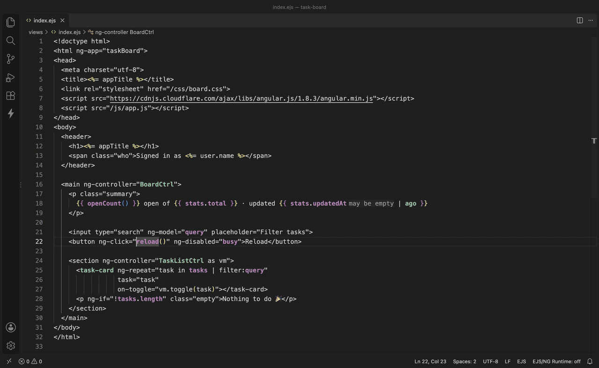
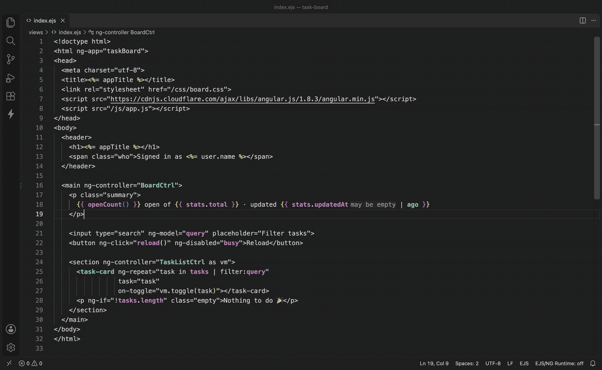
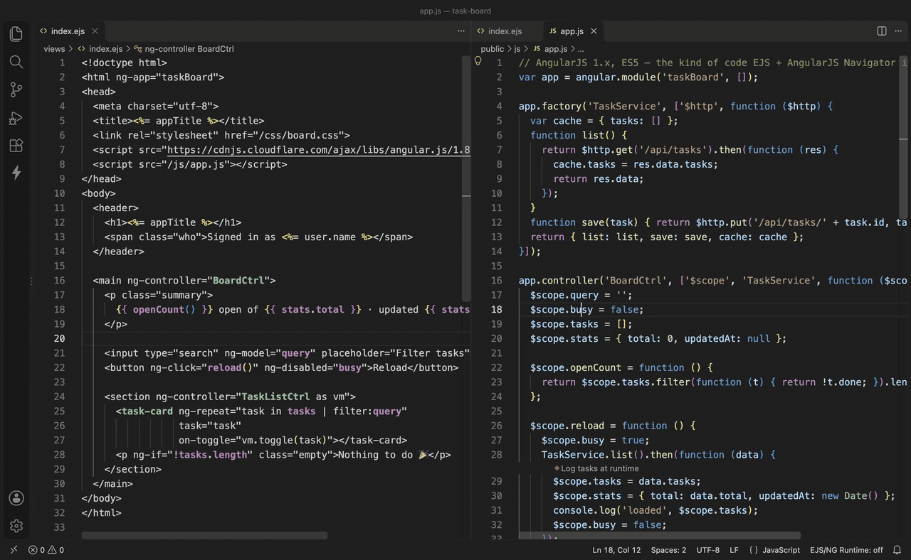
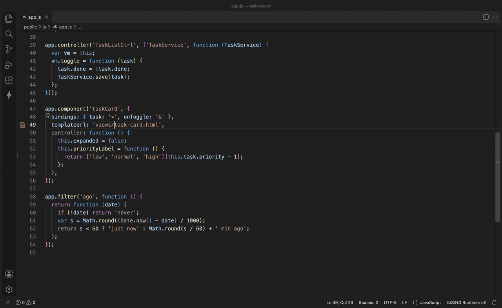
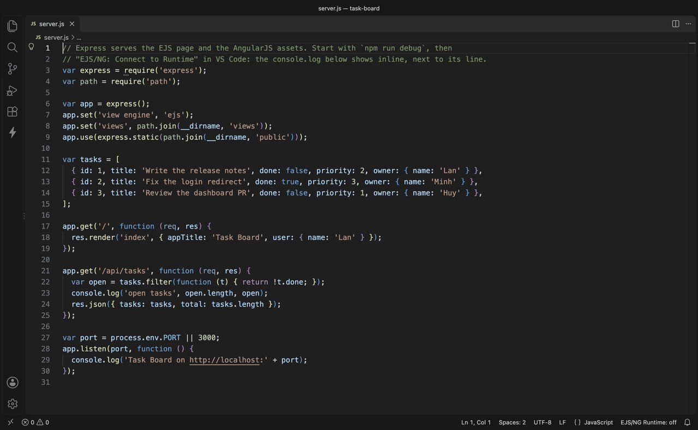
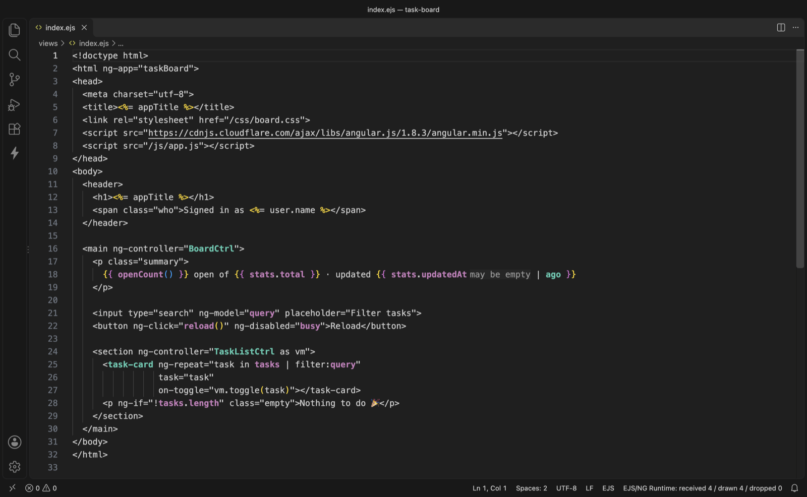

# EJS + AngularJS Navigator

Tracks variables and functions between **EJS** templates and **AngularJS 1.x** (ES5) controllers —
go-to-definition from `{{ expression }}` to `$scope`, find-usages back from controller to
template, and dead-code detection.

One language server (Node/TypeScript), two thin clients: **VSCode** and **IntelliJ**.

> Full design and measurements from a real codebase: [docs/architecture.md](docs/architecture.md)
> (English) / [docs/kien-truc.md](docs/kien-truc.md) (Vietnamese, canonical)

> 🇻🇳 Tiếng Việt: [README.vi.md](README.vi.md)

## Demo

▶️ **[Watch the 1½-minute demo video](docs/media/demo.mp4)** — every clip below, recorded in VS Code on
[`examples/task-board`](examples/task-board/README.md).

| Template → controller and back | AngularJS-aware completion |
|---|---|
|  |  |
| **Rename across JS and templates** | **`templateUrl` ↔ template** |
|  |  |
| **Inline runtime log** | **JS-backed names stand out** |
|  |  |

## What already works

| | Example |
|---|---|
| Template → JS | `data-ng-click="selectSection(section)"` → `$scope.selectSection` |
| Property of an `ng-repeat` variable | `section.icon` → the `icon:` key in the object literal of `$scope.sections` |
| Nested property | `busy.stats` → jumps straight into the `stats:` key in the object literal |
| Local variable | `section` in `ng-repeat="section in sections"` → declaration at that spot |
| `ng-controller` → declaration | even with hyphenated names: `cityos-demo-dha-management-view-controller` |
| JS → Template | `$scope.busy` → every usage in every template |
| Custom directive | `pick-file="onPick($file)"` → `.directive('pickFile', …)` |
| Isolate binding | `<my-widget data="form">` → `bindings: { data: '<' }` |
| Filter | `{{ x | money }}` → `.filter('money', …)` |
| DI | `function ($scope, Api)` → `.factory('Api', …)` (Angular declaration first, parameter second) |
| Plain JS variable | `const`/`let`/`var`/`function`/parameter, following correct scope and shadowing |
| Cross-file global | `DHA_STATUS` declared in `dha.const.js` → used in `dha.controller.js` |
| Global variable | `window`, `JSON`, `$event` → reported as "built-in", not an error |
| EJS axis | `<%= denyMessage %>` → locals from `res.render` |
| Dead code | controller / directive / filter / property that nobody uses |
| Rename | `$scope.busy` → renames every read/write in sync across JS and every template; refuses with a reason on conflict |
| AngularJS-aware completion | `busy.` → `search`, `ingest`…; `section.` → the keys of an element in `sections`; members inherited from a parent controller; `vm.`/`$ctrl.` (a component's bindings too); only filters after `\|`; `<user-` → components/directives, inside a tag → bindings and attribute directives; in `.js`: `$scope.`, `vm.`, `this.` and an injected service (`UserService.` → the keys the factory returns) |
| Files changed outside the editor | `git pull` / checkout / another tool → index auto-updates (VSCode and IntelliJ), no need to re-index manually |
| Observed type | hover `vm.rows` → `{ id: number, tags?: string[] }[]` + where it's assigned; `vm.user` sometimes `= null` → a faint `may be empty` hint |
| JS-backed names colored | In `.ejs`/`.html`, every name a `.js` file defines is drawn in its own color and **bold**: scope variables and their properties (purple), `ng-controller`s/directives/components/filters (teal). Names only the template declares (`ng-repeat`) are left as they are |

### Observed types in hover and inline

Hovering a scope variable in a template (`vm.rows`, `vm.form.name`, an `ng-repeat` item `row`) —
or a `$scope.x = …` / `this.x = …` in a JS file — adds an **Observed type** section: the type merged
from **every** assignment in the controller (a key missing from some assignments becomes `id?`,
different kinds become `A | B`), up to 5 assignment sites as links, and two notes when they apply:
*Can be empty when rendered* (some assignment is `null`/`undefined`) and *Only assigned in a callback*
(no value at the first render). When nothing can be inferred it says why and where from (`res.data`
at `list.controller.js:30`) — never a bare `unknown`.

**Inline** hints are deliberately rare: only `may be empty`, after a variable in an Angular expression
that is explicitly assigned `null`/`undefined`/`void 0` somewhere. No inline hint for a variable only
assigned in a callback (nearly all async-loaded data), in JS files, or for EJS locals. Turn it off with
`ejsng.typeHints.nullable`.

**Types seen at runtime.** Where the index can't tell (`$scope.rows = res.data`), let the runtime show
it: click **Log at runtime** — on the **CodeLens** above the assignment in the controller, or in the hover (beside "Could not be inferred — assigned from
`res.data`") — VS Code sets an ordinary logpoint right after that assignment, even inside a one-line
callback; clicking again never adds a second one, and it's removed through the usual breakpoint UI. A
logpoint `{vm.rows}` of your own, or an existing `console.log($scope.rows)`, works too. While Runtime Log
is connected, next time that line runs, hovering `vm.rows` in the template shows the real
type, with a *Seen at runtime* line (how often, when, from which connection). Only the type is kept,
never the value; disconnecting drops it. The status bar counts `N types seen`. Inline hints never change
because of the runtime. Details: `docs/architecture.md` section 5.3.2.

## Getting started

```bash
npm install && npm run build
```

CLI (runs right away, no IDE needed):

```bash
node packages/cli/dist/index.js index --root /path/to/your/repo
```

```bash
node packages/cli/dist/index.js def /path/to/view.ejs 41 38 --root /path/to/your/repo
```

```bash
node packages/cli/dist/index.js refs /path/to/controller.js 53 11 --root /path/to/your/repo
```

```bash
node packages/cli/dist/index.js unused --root /path/to/your/repo
```

Coverage sweep — try to resolve **every** identifier in **every** template, and report what's
still missing:

```bash
node packages/cli/dist/index.js sweep --root /path/to/your/repo
```

The end of the output lists every `templateUrl` that could not be linked (a dynamic expression, no
matching file, or one template given several controllers). Pass `templateRoots` on the CLI with
`--template-root /views/=src/views=.ejs,.html` (repeatable) and `--views-dir src/views`.
The Express server code is read too (`express.static`, `app.set('views')`, a `/partials/:name` route
calling `res.render(...)`), `.html` is also looked for as `.ejs`, and links set by hand in
`.vscode/settings.json` (`ejsng.templateUrlMap`, or `--template-map url=file`) always come first.
Usually not needed: a `templateUrl` written the way Angular reads it (relative to the page, e.g.
`'views/list.html'` in `public/js/app.js`) is looked up under the directories above the JS file, then
by the end of its path. `templateRoots` is only for a URL that differs from the path on disk (its own
prefix, `.html` served from `.ejs`).

Locate by string instead of counting columns (use this to inspect one specific expression):

```bash
node packages/cli/dist/probe.js <file> "section.enabled" --offset 8 --root /path/to/your/repo
```

Preview a rename — list every location that would be edited, **without writing any file**:

```bash
node packages/cli/dist/probe.js <file> "\$scope.busy = " --offset 7 --rename isBusy --root /path/to/your/repo
```

`ejsng scan <file>` prints every fact extracted from one file — the main debugging tool.

## Trying it in VSCode

Open this folder in VSCode, press F5 to launch the Extension Development Host, then open your
AngularJS repo in the new window — or [`examples/task-board`](examples/task-board/README.md), a small
Express + EJS + AngularJS app with a guided tour of every feature.

## Trying it in IntelliJ

`packages/intellij-client` is a Gradle plugin that uses **LSP4IJ** (open-source, Red Hat) instead
of JetBrains' built-in LSP API — that API only runs on paid IDE tiers. Licensing details:
[docs/architecture.md, Appendix B](docs/architecture.md).

Any JDK ≥ 17 is needed to run Gradle; JDK 21, used for compilation, is fetched automatically by
foojay.

```bash
cd packages/intellij-client && ./gradlew verifyPluginProjectConfiguration verifyPluginStructure
```

```bash
cd packages/intellij-client && ./gradlew buildPlugin verifyPlugin
```

```bash
cd packages/intellij-client && ./gradlew runIde
```

Installable artifact: `packages/intellij-client/build/distributions/ejsng-intellij-0.1.0.zip`
(Settings → Plugins → ⚙ → Install Plugin from Disk).

**Node:** the plugin locates Node itself via `NodeLocator` — supporting nvm, fnm, volta, asdf,
nodenv, and system paths. This is necessary because an IDE launched from the Dock does not
inherit the shell's PATH. Force a specific path with the `EJSNG_NODE` environment variable.

## Configuration

| Key | Default | Notes |
|---|---|---|
| `ejsng.moduleAliases` | `["myApp","app","appModule"]` | Variables holding the Angular module but declared in another file |
| `ejsng.ejsDelimiter` | `"%"` | Change to `"?"` for `<? ?>` |
| `ejsng.customDirectives` | `{}` | `{"myOn": "statement"}` — the company's own custom directives |
| `ejsng.templateRoots` | `[]` | Maps `templateUrl` to files: `[{"urlPrefix": "/views/", "fsPath": "src/views", "extensions": [".ejs", ".html"]}]` — the template is then linked to the controller of the directive/component/route/state using it |
| `ejsng.expressViewsDir` | `"views"` | Express views directory for `res.render('user/profile')` |
| `ejsng.diagnostics.enabled` | `false` | **Off by default** to avoid thousands of false warnings on legacy code |
| `ejsng.runtimeLog.expandValues` | `true` | Expand objects and arrays in inline logs instead of `[Object]`; asks the running app, rate limited per line |
| `ejsng.logLens` | `"unknown"` | The **Log at runtime** CodeLens above an assignment: `unknown` only where the index can't type it (~3% of lines), `all` on every assignment (15-18%), `off` for none |
| `ejsng.typeHints.nullable` | `true` | Inline `may be empty` hint after a variable assigned `null`/`undefined` somewhere. Hover has no setting. Reload the window after changing it |
| `ejsng.templateHighlight.enabled` | `true` | Colors and bolds template names defined in JavaScript. Change the colors in `workbench.colorCustomizations`: `ejsng.linkedScope.foreground`, `ejsng.linkedDeclaration.foreground` |
| `ejsng.include` / `exclude` | | Glob patterns for file scanning |

## Architecture

```
packages/core/            All the logic — no LSP dependency, testable standalone
  src/ejs/scanner.ts        Scans EJS regions, builds the virtual HTML/JS
  src/ng/lexer,parser,ast   Angular expression parser (NOT JavaScript)
  src/ng/microsyntax.ts     ng-repeat / ng-options
  src/ng/normalize.ts       data-ng-* → ngX, directive syntax table
  src/extract/js.ts         Layer 2: facts from .js (pure per-file)
  src/extract/template.ts   Layer 2: facts from .ejs (pure per-file)
  src/index/store.ts        Layer 3: NDJSON + in-memory lookup tables (Appendix D)
  src/resolve/linker.ts     Layer 4: cross-file linking
  src/resolve/workspace.ts  Queries: definition / references / completion / rename
  src/resolve/rename.ts     Rename: scans $scope, scoping when controllers share a name
packages/server/          LSP server
  test/lsp.test.js          Tests over stdio: the real server, JSON-RPC like an IDE
packages/cli/             CLI — debugging and benchmarking without an IDE
packages/vscode-client/   VSCode extension
packages/intellij-client/ IntelliJ plugin (Kotlin + LSP4IJ)
fixtures/mini/            A scaled-down repo for tests
```

**The most important constraint of this codebase:** a Layer 2 fact must be a **pure function of
the content of a single file** — it must not read another file, and must not query the index.
That's the condition that makes caching correct. Any conclusion that needs cross-file information
must live in Layer 4 (`linker.ts`). Whenever extractor logic changes, you **must bump
`PARSER_VERSION`** in `src/index/schema.ts` — otherwise the old index gets reused and produces
wrong results.

## Tests

```bash
npm test
```

Runs the core tests and the LSP tests over stdio (spinning up a real server). Tests against the
`smart-city` repo skip themselves automatically if that repo isn't present on the machine.
`spans.test.js` enforces the invariant "every span points exactly at the text it represents" — see
[Appendix I](docs/architecture.md).

## Logged objects, shown as objects

Objects and arrays in inline logs read as themselves instead of `[Object]`: the extension asks the running app
for the value's properties (`Runtime.getProperties`), at most once per line per 300 ms. The hover lays the value
out; **Open as JSON** (in the hover, next to **Inspect** and **Copy**) opens a read-only JSON tab with the whole thing, where folding, search and copy are VS
Code's own. Measured against a real Chrome page logging 33 times a second: the app runs **exactly as fast** as
with the feature off. Turn it off with `ejsng.runtimeLog.expandValues`.

**Runtime Values** — a tab in the bottom panel, next to Terminal — reads like a debugger: every line that logged,
newest first, and the selected hit's value as a tree (`name = {Type} preview`), colored by kind, expandable with the
mouse or the arrow keys. **Inspect** in the hover opens it on that line.

### Three ways to set a logpoint, none of them typing

| Way | When |
|---|---|
| The **CodeLens** above an assignment | reading a controller, after the value it just assigned |
| **Right-click → EJS/NG: Log This at Runtime** | any line, any expression: a local, a parameter, `res.data` |
| **`Cmd+Alt+L`** (`Ctrl+Alt+L` on Windows/Linux) | the same, once it's in your fingers |

All three produce the **same** logpoint: the message `rows = {$scope.rows}`, placed right after the assignment
(so the value is the new one) or at the start of the line (so it is the value the line is about to use). Doing it
again in the same place removes it. The extension **refuses, with a reason**, to log a function call (which would
run on every hit) or `this` inside a callback (which is no longer the controller).

## Trying "Log at runtime"

[`examples/log-at-runtime/`](examples/log-at-runtime/README.md) is a controller that runs under plain
`node --inspect` (no browser needed): hover a variable the index can't type, click **Log at runtime**, connect
the runtime, hover again to see the real type. Seven steps in that folder's README.
